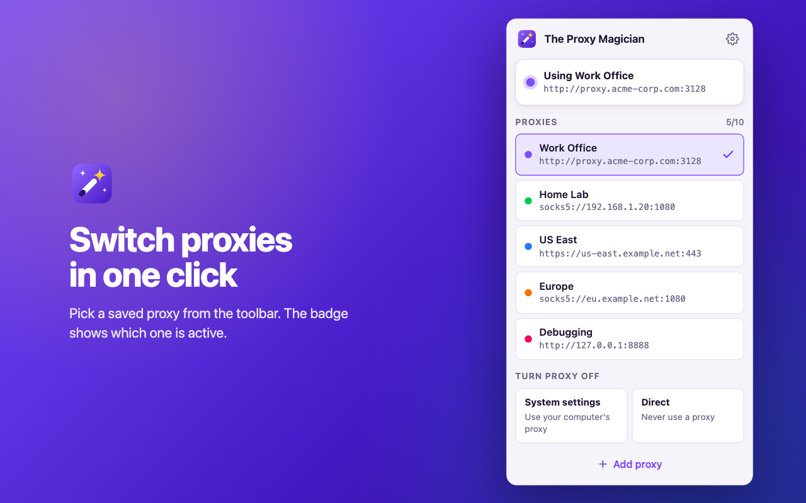

# The Proxy Magician

A free Chrome extension (Manifest V3) for saving up to **10 proxy servers** and switching between them in one click.



## Features

- Up to 10 saved proxies, each with a name and color
- HTTP, HTTPS, SOCKS4 and SOCKS5
- One-click switching from the toolbar; the badge shows the active proxy
- Automatic sign-in for HTTP/HTTPS proxies with a username and password
- Per-proxy bypass list
- "System settings" and "Direct" modes to turn the proxy off
- Warnings when another extension or a policy controls the proxy, and when the proxy fails
- Export and import as JSON
- Light and dark mode
- No network requests, analytics or remote code

## Try it locally

1. Open `chrome://extensions`
2. Turn on **Developer mode** (top right)
3. Click **Load unpacked** and select this folder
4. Pin the extension and click the wand icon

## Project layout

```
manifest.json            Extension manifest (MV3)
src/
  background.js          Service worker: applies proxy settings, badge, proxy auth
  shared.js              Storage, validation and constants shared by all pages
  popup.html/.css/.js    Toolbar popup (quick switch)
  options.html/.css/.js  Manage proxies (add / edit / delete / import / export)
  styles.css             Shared design tokens and components
icons/                   Extension icons (generated)
docs/privacy.html        Privacy policy page to host (e.g. GitHub Pages)
PRIVACY.md               Privacy policy (Markdown)
store/
  STORE_LISTING.md       Everything to paste into the Chrome Web Store dashboard
  assets/                Store icon, screenshots and promo tiles (generated)
  src/                   Sources for the icon and store images
scripts/
  render-assets.sh       Renders icons + store images with headless Chrome
  package.sh             Builds dist/the-proxy-magician-<version>.zip
```

## Build

```sh
./scripts/render-assets.sh   # only needed if you change the icon or want new screenshots
./scripts/package.sh         # creates dist/the-proxy-magician-1.0.0.zip
```

`render-assets.sh` uses Google Chrome at `/Applications/Google Chrome.app`; set `CHROME=/path/to/chrome` to use another location.

## Publish to the Chrome Web Store

Follow [store/STORE_LISTING.md](store/STORE_LISTING.md). It has the description, permission justifications, data-usage answers and a submission checklist.

To release an update, bump `version` in `manifest.json`, run `./scripts/package.sh` and upload the new zip.

## How it works

- Proxies and the active mode live in `chrome.storage.local`.
- The service worker is the only place that calls `chrome.proxy.settings`. The popup and options page send it a `setState` message.
- Editing or deleting the active proxy re-applies it automatically (or falls back to system settings).
- Proxy sign-in uses `chrome.webRequest.onAuthRequired` with `asyncBlocking`. It needs the optional `<all_urls>` host permission, which is requested only when you save a proxy with a username. After two failed attempts on a request the extension stops answering, so Chrome shows its own login prompt instead of looping.
- Chrome does not support SOCKS proxy authentication, so credentials are only used for HTTP/HTTPS proxies.

## License

MIT
